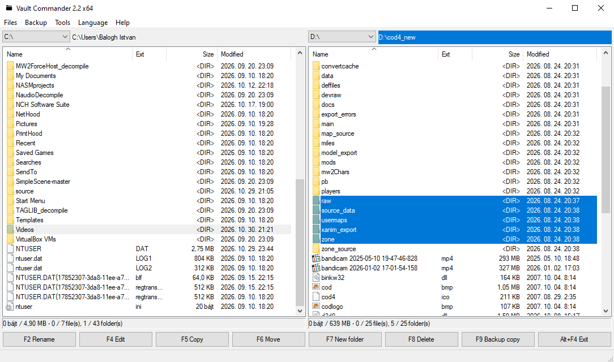
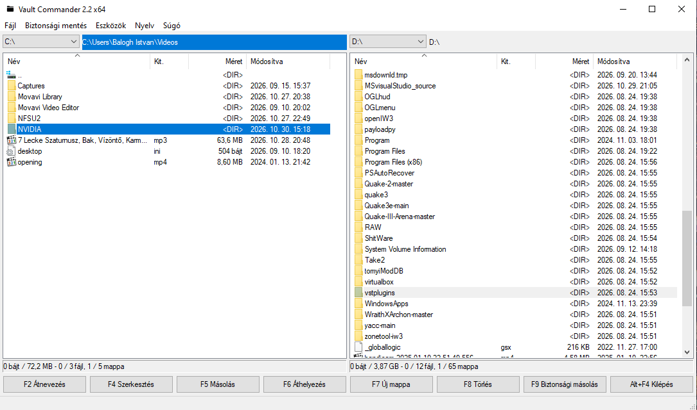

# Vault Commander

A lightweight, dual-pane file manager inspired by Total Commander[cite: 1], designed for Windows (available in both **32-bit (x86)** and **64-bit (x64)** architectures).

---

## 🌟 Key Features

* **Dual-Pane Interface:** Clean and efficient two-panel layout for fast file management and transfers[cite: 1].
* **Standard File Operations:** Essential features including browsing, sorting, viewing, renaming (F2), editing (F4), copying (F5), moving (F6), creating new folders (F7), and deleting (F8)[cite: 1, 2].
* **🛡️ Smart Backup Copying (Extra Feature):** 
  * Separate options for standard copying and **Backup Copying**.
  * When you execute a backup copy, the app automatically creates a brand-new folder named after the **exact current date and time** (never overwriting previous backups) and places your selected files inside it.
* **Bilingual Support:** Fully supports both **English** and **Hungarian** languages.
* **Cross-Device & Mobile Support:** Browse and transfer files to/from connected mobile devices (USB phones) directly in the drive dropdown menu, complete with path navigation and specific status info[cite: 2].
* **Advanced Selection & Drag & Drop:** 
  * Smart `Ctrl` + arrow key selection mechanics.
  * Drag and drop support between panels, to Windows Explorer, or vice versa with modifier key support (`Ctrl` to copy, `Shift` to move)[cite: 2].
* **Context Menus:** Full Windows Explorer right-click integration, featuring the quick **Backup copy** option right at the top[cite: 2].
* **Per-Panel Status Bars:** Real-time metrics for selected sizes, total sizes, file counts, and folder counts[cite: 2].

---

## ⌨️ Shortcuts & Operations

| Function | Shortcut / Action |
| :--- | :--- |
| **Rename** | `F2` (Smart selection: highlights only the file name, preserving the extension)[cite: 2] |
| **Edit** | `F4`[cite: 1] |
| **Copy** | `F5`[cite: 1] |
| **Move** | `F6`[cite: 1] |
| **New Folder** | `F7`[cite: 1] |
| **Delete** | `F8`[cite: 1] |
| **Backup Copy** | `F9` (or via Explorer right-click menu)[cite: 1, 2] |
| **Exit** | `Alt + F4`[cite: 1] |

---

## 📥 Download & Releases

You can download the latest compiled binaries for Windows from the [Releases](../../releases) page:
* **x64** (64-bit systems)
* **x32 / x86** (32-bit systems)

---

## 🛠️ Built With

* Developed for Windows Desktop environments with a focus on speed, simplicity, and safety through timestamped backups.

---

## Media

